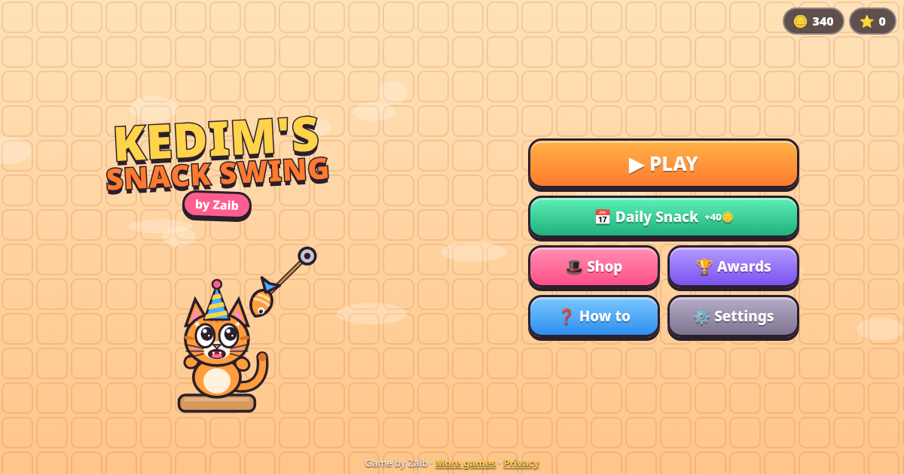
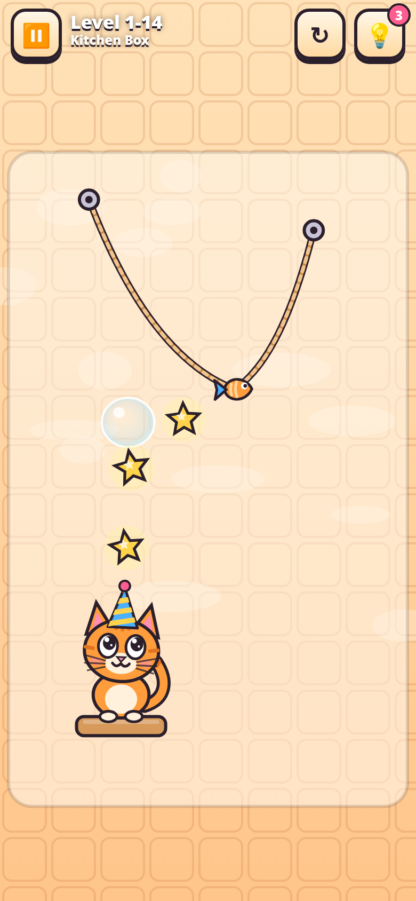

# Kedim's Snack Swing 🐱🐟

**A rope-cutting physics puzzle game by Zaib.**

▶ **Play:** https://zaibgames.com/kedim-snack-swing/

Kedim the cat is hungry! A fish treat hangs from ropes. Swipe to cut them, swing the treat past spikes and spiders, collect the stars and drop dinner straight into Kedim's mouth.

## Features
- **120 levels in 6 themed snack boxes:** Kitchen, Garden, Toy, Space, Magic and Spooky. Boxes unlock with stars.
- **Mechanics arrive one at a time:** ropes, bubbles, air cushions, spikes, moving pins, auto-ropes, the gravity switch, bouncy pads, portals and timed spiders.
- **Every level is verified solvable.** A deterministic physics core is shared by the game and the level generator, so stored solutions replay exactly. An automated solver finds a 3-star solution for every level, checks that it still works with human-style timing errors, and checks that each cut can be made with a swipe that doesn't touch another rope. A browser bot then plays all 150 levels (120 main + 30 daily) in the real game.
- **3 stars per level**, coins, a daily level with a streak bonus, and 20 achievements.
- **Hints** replay the full solution with a ghost hand. You start with 3. More cost coins, and a level stays free to re-watch once you've used a hint on it.
- **Shop:** 9 treat skins and 11 hats for Kedim.
- **Expressive Kedim:** idle animations (breathing, blinking, tail swish, yawning, eyes that follow the treat), hungry (mouth opens wider as the treat gets close, drools, waves his paws), happy (chomp, chew, hearts) and sad (droopy ears, tears).
- **Polish:** synthesized WebAudio music and sound effects through a master limiter, haptics, particles, and screen shake.
- **Saving:** progress is stored in localStorage.
- **Performance:** a single self-contained HTML file. It's mobile-first and works in portrait and landscape, respects safe areas, runs at 60 fps with a fixed physics step, drops graphics quality automatically if the frame rate falls, and pauses when the tab is hidden.

## Controls
| Action | Touch / Mouse | Keyboard |
|---|---|---|
| Cut a rope | Swipe or drag across it | 1-9 |
| Pop the bubble | Tap the treat | Space |
| Air cushion | Tap it | Q / E |
| Gravity switch | Tap it | G |
| Restart / Hint / Pause | HUD buttons | R / H / Esc |

## Credits
Game, art, music and code by **Zaib**. All characters, art and sounds are original.

More games: https://zaibgames.com/ · Privacy: https://zaibgames.com/privacy/
